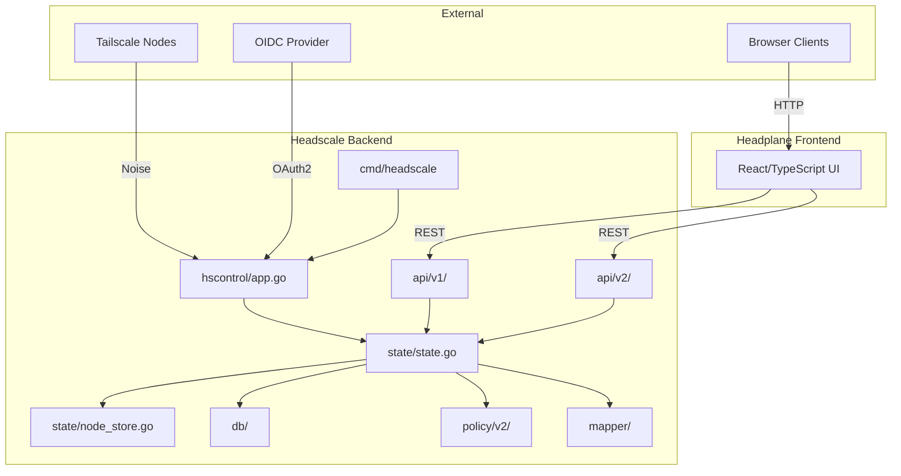

# Code Graph

A persistent structural map of the Headscale codebase, designed to help AI agents and developers understand the project architecture instantly and reduce exploratory file reads.

> **Last Updated:** 2026-10-13  
> **Version Context:** Go 1.27.0, arsydoni4326-alt fork with Headplane frontend

---

## Table of Contents

1. [Visual Architecture](#visual-architecture)
2. [Project Structure Overview](#project-structure-overview)
3. [Core Module Index](#core-module-index)
4. [Data Flow Patterns](#data-flow-patterns)
5. [Key Architectural Patterns](#key-architectural-patterns)
6. [Testing Infrastructure](#testing-infrastructure)
7. [Build and Development](#build-and-development)

---

## Visual Architecture

### High-Level System Diagram



---

## Project Structure Overview

```
headscale/
├── cmd/                        # Entry points and CLI tools
│   ├── headscale/              # Main server binary
│   ├── hi/                     # Integration test runner (Docker orchestration)
│   ├── dev/                    # Development server
│   ├── gen-openapi/            # OpenAPI spec generator
│   └── vendorhash/             # Nix vendor hash updater
│
├── hscontrol/                  # Core control plane
│   ├── app.go                  # Server initialization & orchestration
│   ├── handlers.go             # HTTP request handlers
│   ├── noise.go                # Noise protocol handshake
│   ├── auth.go                 # Node authentication
│   ├── oidc.go                 # OIDC authentication flow
│   ├── poll.go                 # Long-polling for map updates
│   │
│   ├── state/                  # Central state coordinator
│   │   ├── state.go            # Main State coordinator
│   │   ├── node_store.go       # Copy-on-write NodeStore
│   │   └── tags.go             # Tag ownership validation
│   │
│   ├── db/                     # Database layer (GORM)
│   │   ├── db.go               # Database connection & setup
│   │   ├── migrations.go       # Schema migrations
│   │   ├── node.go             # Node persistence
│   │   ├── users.go            # User management
│   │   └── secret.go           # Unified credentials table
│   │
│   ├── policy/v2/              # Policy engine
│   │   ├── policy.go           # PolicyManager core
│   │   ├── acls.go             # ACL evaluation
│   │   └── ssh.go              # SSH grants
│   │
│   ├── mapper/                 # MapResponse distribution
│   │   ├── batcher.go          # Batch streaming
│   │   ├── node_conn.go        # Per-node connection
│   │   └── builder.go          # MapResponse builder
│   │
│   ├── api/v1/                 # REST API v1 (Huma-based)
│   │   ├── nodes.go            # Node management
│   │   ├── users.go            # User management
│   │   ├── keys.go             # Key management
│   │   └── derp.go             # DERP map endpoint
│   │
│   ├── api/v2/                 # REST API v2 (newer, RESTful)
│   │   ├── devices.go          # Device management
│   │   ├── users.go            # User management
│   │   └── acl.go              # ACL management
│   │
│   ├── types/                  # Core domain types
│   │   ├── node.go             # Node struct & methods
│   │   ├── users.go            # User struct & methods
│   │   └── config.go           # Configuration types
│   │
│   ├── derp/                   # DERP relay management
│   ├── dns/                    # MagicDNS implementation
│   ├── routes/                 # Route management
│   ├── servertest/             # In-memory test harness
│   └── updatecheck/            # Update check (fork-specific)
│
├── integration/                # Docker-based integration tests
│   ├── scenario.go             # Test scenario orchestrator
│   ├── hsic/                   # Headscale container wrapper
│   └── tsic/                   # Tailscale client container wrapper
│
├── gen/client/                 # Generated API clients
├── docs/                       # User documentation
├── nix/                        # NixOS modules & packaging
├── tools/bump/                 # Dependency version bumper
└── headplane/                  # Frontend (submodule)
```

---

## Core Module Index

### Entry Points

#### [cmd/headscale/main.go]
- **Role:** Entry point for the Headscale server binary.
- **Exports:** `main()` function.
- **Dependencies:** `hscontrol/app.go`, `cobra`, `viper`, Go stdlib.
- **Incoming References:** Binary execution, Dockerfile, systemd, Nix packages.
- **Key Functions:**
  - `main()` → Parses CLI args, loads config, initializes and starts the server.

#### [cmd/hi/]
- **Role:** Integration test runner; orchestrates Docker containers for Headscale + Tailscale clients.
- **Exports:** CLI commands (`run`, `doctor`, `clean`, `stats`).
- **Dependencies:** `integration/`, Docker SDK, Go stdlib.
- **Incoming References:** CI workflows, developer CLI.
- **Key Functions:**
  - `runTests(pattern, opts)` → Spins up test environment, runs matching tests, collects artifacts.
  - `doctor()` → Verifies Docker, disk space, images.
- **Documentation:** See `cmd/hi/README.md` for complete usage patterns.

---

### Core Server (hscontrol/)

#### [hscontrol/app.go]
- **Role:** Top-level server orchestrator; wires together all subsystems, HTTP server, DERP, gRPC.
- **Exports:** `Headscale` struct, `NewHeadscale()`, `Serve()`.
- **Dependencies:** `state/`, `db/`, `mapper/`, `policy/`, `api/v1`, `api/v2`, `derp/`, `dns/`, `types/`.
- **Incoming References:** `cmd/headscale/main.go`, test harnesses.
- **Key Functions:**
  - `NewHeadscale(cfg)` → Initializes DB, State, PolicyManager, Mapper, HTTP routes.
  - `Serve()` → Starts HTTP/gRPC servers, DERP relay, handles graceful shutdown.

#### [hscontrol/noise.go]
- **Role:** Implements Tailscale Noise protocol handshake for client connections.
- **Exports:** Noise handlers, protocol state management.
- **Dependencies:** `auth.go`, `state/`, `types/`, Noise crypto.
- **Incoming References:** `app.go` (route registration).
- **Key Functions:**
  - `NoiseUpgradeHandler()` → Upgrades HTTP to Noise protocol.
  - `noisePollNetMapHandler()` → Handles `/machine/{...}/map` long-poll requests.

#### [hscontrol/auth.go]
- **Role:** Node authentication and registration logic; validates auth credentials.
- **Exports:** Auth handlers, registration functions.
- **Dependencies:** `state/`, `db/`, `types/`, `oidc.go`.
- **Incoming References:** `noise.go`, `poll.go`, `app.go`.
- **Key Functions:**
  - `handleAuthKey()` → Validates pre-auth keys, registers nodes.
  - `RegisterNode(authID, userID)` → Completes node registration, assigns to user.

---

### State Management (hscontrol/state/)

#### [hscontrol/state/state.go]
- **Role:** Central coordinator for all cross-subsystem operations; owns NodeStore, PolicyManager.
- **Exports:** `State` struct, node/user/policy management methods.
- **Dependencies:** `db/`, `policy/`, `types/`, `util/`.
- **Incoming References:** `app.go`, `mapper/`, `api/v1`, `api/v2`, `handlers.go`, `auth.go`.
- **Key Functions:**
  - `UpdateNodeFromMapRequest(node, hostinfo, endpoints, routes)` → **Sync point** for client state updates.
  - `AllocateIPForNode(node)` → Assigns IP addresses to nodes.
  - `GetFilteredPeers(node)` → Returns policy-filtered peer list.
  - `UpdatePolicy(pol)` → Reloads policy, triggers network-wide recompute.
  - `NotifyAll(change)` → Broadcasts change notifications to Mapper.

#### [hscontrol/state/node_store.go]
- **Role:** Copy-on-write in-memory cache of all nodes; provides atomic snapshot reads.
- **Exports:** `NodeStore` struct, read/write operations.
- **Dependencies:** `types/`, `prometheus`, `atomic`.
- **Incoming References:** `state.go`, `mapper/`.
- **Key Functions:**
  - `Put(node)` → Queues write, batches updates, rebuilds snapshot.
  - `Get(nodeID)` → Atomic pointer load, returns `NodeView`.
  - `ListAll()` → Returns slice of all nodes from current snapshot.
- **Performance:** Every read is an atomic pointer dereference; writes rebuild full snapshot.

---

### Database Layer (hscontrol/db/)

#### [hscontrol/db/db.go]
- **Role:** Database connection setup, transaction helpers, migration runner.
- **Exports:** `HSDatabase` struct, `NewHSDatabase()`.
- **Dependencies:** `gorm`, `sqlite`/`postgres` drivers, `gormigrate`.
- **Incoming References:** `app.go`, all other `db/*.go` files.
- **Key Functions:**
  - `NewHSDatabase(driver, dsn)` → Opens DB, runs migrations, returns `HSDatabase`.
  - `Transaction(fn)` → Wraps operations in a transaction with rollback.

#### [hscontrol/db/node.go]
- **Role:** Node persistence, peer listing, node queries.
- **Exports:** Node CRUD, `ListPeers()`, `GetNode*()` methods.
- **Dependencies:** `types/`, `gorm`, `util/`.
- **Incoming References:** `state/state.go`, `api/v1`, `api/v2`.
- **Key Functions:**
  - `SaveNode(node)` → Persists node to DB.
  - `ListPeers(nodeID, peerIDs...)` → Returns peers regardless of policy (raw DB query).

#### [hscontrol/db/migrations.go]
- **Role:** Database schema migrations (using gormigrate).
- **Exports:** Migration list, version checks.
- **Dependencies:** `gorm`, `gormigrate`, `types/`.
- **Key Functions:**
  - `migrations` → Array of migration definitions (ordered, immutable).
- **Migration Rules:** Never reorder; only append; never use `AutoMigrate`; explicit DDL only.

---

### Policy Engine (hscontrol/policy/)

#### [hscontrol/policy/v2/policy.go]
- **Role:** Policy compilation, ACL evaluation, filter rule generation, SSH grants.
- **Exports:** `PolicyManager` struct, evaluation methods.
- **Dependencies:** `matcher/`, `policyutil/`, `types/`, `xsync`, `netipx`.
- **Incoming References:** `state/state.go`, `app.go`.
- **Key Functions:**
  - `CompileFilterRules(policy, users, nodes)` → Generates `[]tailcfg.FilterRule` from policy.
  - `GetRulesForNode(nodeView)` → Returns policy-filtered rules for a specific node.
  - `AutoApproveRoutes(node, routes)` → Determines which routes to auto-approve.
- **Cache Strategy:** Per-node `xsync.Map` for filter rules; invalidated on policy/node/user change.

---

### Network Services

#### [hscontrol/mapper/]
- **Role:** Streams MapResponse updates to connected clients; batches changes.
- **Exports:** `Mapper` struct, `Batcher`, `NodeConn`.
- **Dependencies:** `state/`, `types/`, `tailcfg`.
- **Incoming References:** `app.go`, `poll.go`, `state/state.go`.
- **Key Functions:**
  - `Batcher` → Aggregates change notifications, debounces, sends batch updates.
  - `buildMapResponse(node, peers, policy)` → Constructs `tailcfg.MapResponse`.
- **Performance:** Hot path for all connected clients; NodeStore atomic reads enable lock-free iteration.

---

### REST APIs (hscontrol/api/)

#### [hscontrol/api/v1/]
- **Role:** REST API v1; code-first Huma definitions, OpenAPI 3.1 emission.
- **Exports:** API handlers, OpenAPI schema.
- **Dependencies:** `state/`, `db/`, `types/`, `huma`.
- **Incoming References:** `app.go`, Headplane frontend, API clients.
- **Key Endpoints:**
  - `/api/v1/node` → Node management
  - `/api/v1/user` → User management
  - `/api/v1/preauthkey` → Pre-auth keys
  - `/api/v1/policy` → Policy upload/download
  - `/api/v1/derp` → DERP map (read-only)
  - `/api/v1/update-check` → Update check (fork-specific)

#### [hscontrol/api/v2/]
- **Role:** REST API v2; more RESTful design, OAuth2 scoped access.
- **Exports:** API handlers, OAuth2 scope enforcement.
- **Dependencies:** `state/`, `db/`, `types/`, `scope/`, `huma`.
- **Key Endpoints:**
  - `/api/v2/devices` → Device management
  - `/api/v2/users` → User management
  - `/api/v2/acl` → ACL management

---

### Core Types (hscontrol/types/)

#### [hscontrol/types/node.go]
- **Role:** Node struct definition, ownership methods, view types.
- **Exports:** `Node`, `NodeView`, ownership helpers.
- **Key Functions:**
  - `IsTagged()` → Returns true if node is owned by tags (authoritative check).
  - `IsUserOwned()` → Returns `!IsTagged()`.
  - `View()` → Returns immutable `NodeView` for safe concurrent reads.

#### [hscontrol/types/users.go]
- **Role:** User struct definition, special users.
- **Exports:** `User`, `UserView`, `TaggedDevices`.
- **Key Constants:**
  - `TaggedDevices` → Synthetic user (ID 2147455555) for tagged nodes.

---

## Data Flow Patterns

### Node Registration Flow

1. **Client initiates connection** → Tailscale node connects to server URL.
2. **Noise handshake** (`noise.go`) → Upgrades HTTP to Noise protocol, validates machine key.
3. **Authentication** (`auth.go`):
   - Pre-auth key → Immediate registration.
   - OIDC → Redirect to provider, callback, confirmation page.
   - Interactive → Generate auth ID, serve registration page with QR code.
4. **State persistence** (`state/state.go`, `db/node.go`) → Node saved to DB, added to NodeStore.
5. **Initial map** (`mapper/builder.go`) → Build `MapResponse` with network state.
6. **Long poll** (`poll.go`) → Keep connection open for future updates.

### Map Update Flow

1. **Change trigger**:
   - Client updates (hostinfo, endpoints, routes) → `UpdateNodeFromMapRequest()`
   - Policy change → `UpdatePolicy()`
   - Node expiry/deletion → `ExpireNode()`, `DeleteNode()`
2. **State update** (`state/state.go`) → Writes to NodeStore, triggers policy recompute if needed.
3. **Change notification** → `NotifyAll(change)` enqueues change.
4. **Batching** (`mapper/batcher.go`) → Debounces rapid changes, sends batch updates.
5. **MapResponse generation** → Builds per-node view with policy-filtered peers.
6. **Streaming** (`mapper/node_conn.go`, `poll.go`) → Sends update to connected clients.

### Tags-as-Identity Enforcement

- **Invariant:** Every node is **either** tagged (owned by tags) **or** user-owned, never both.
- **Authoritative check:** `node.IsTagged()` (not `node.UserID().Valid()`).
- **Enforcement point:** `state/tags.go:validateNodeOwnership()` (called during `SetTags`).
- **Presentation:** Tagged nodes show as owned by synthetic `TaggedDevices` user.

---

## Key Architectural Patterns

### Copy-on-Write NodeStore

- **Location:** `hscontrol/state/node_store.go`
- **Pattern:** Atomic pointer to immutable snapshot; reads are lock-free.
- **Read:** `atomic.Load()` → O(1) pointer dereference.
- **Write:** Queue operations, batch, rebuild full snapshot, `atomic.Store()`.
- **Trade-off:** Fast reads (hot path), slower writes (acceptable for control plane).

### Code-First API (Huma)

- **Pattern:** Define API in Go code; OpenAPI spec is generated, not written.
- **Location:** `hscontrol/api/v1/`, `hscontrol/api/v2/`
- **Benefits:** Spec cannot drift from implementation; type-safe handlers.
- **Emission:** `cmd/gen-openapi/` generates spec for external consumers.

### Database Migration Immutability

- **Rules:** Never reorder, only append, explicit DDL, no `AutoMigrate`.
- **Location:** `hscontrol/db/migrations.go`
- **Rationale:** Prevents corruption on upgrade; rollback is drop DB and restore backup.

---

## Testing Infrastructure

### [hscontrol/servertest/]
- **Role:** In-memory test harness for server-level tests without Docker.
- **Exports:** `Harness`, `NewHarness()`, client builders.
- **Key Functions:**
  - `NewHarness()` → Spins up in-memory server with SQLite.
  - Faster than integration tests; prefer for unit/server logic tests.

### [integration/]
- **Role:** Docker-based end-to-end tests with real Tailscale clients.
- **Key Components:**
  - `scenario.go` → `Scenario` orchestrates test environment.
  - `hsic/` → Headscale container wrapper.
  - `tsic/` → Tailscale client container.
- **Documentation:** See `integration/README.md` for authoring patterns.

### [cmd/hi/]
- **Role:** Integration test runner; Docker orchestration, artifact collection.
- **Key Features:**
  - `run [pattern]` → Executes tests, collects logs to `control_logs/{runID}/`.
  - `doctor` → Pre-flight checks (Docker, images, disk space).
  - `--postgres` → Run tests against PostgreSQL.
- **Documentation:** See `cmd/hi/README.md` for complete usage.

---

## Build and Development

### [Makefile]
- **Targets:**
  - `make build` → Compiles `headscale` binary.
  - `make test` → Runs unit tests (`go test -race ./...`).
  - `make lint` → `golangci-lint run`.
  - `make fmt` → Auto-format Go, docs, Nix files.
  - `make generate` → Protobuf + API client generation.
  - `make dev` → Full cycle (fmt + lint + test + build).

### [go.mod]
- **Minimum Go:** 1.27.0
- **Key Dependencies:**
  - `tailscale.com` → Core protocol types.
  - `gorm.io/gorm` → Database ORM.
  - `github.com/danielgtaylor/huma/v2` → REST API framework.
  - `modernc.org/sqlite` → Pure-Go SQLite (must match `libc` version).
- **NOTE Blocks:** Document fragile dependencies (sqlite/libc lockstep).

### [flake.nix]
- **Outputs:**
  - `devShells.default` → Development environment (`nix develop`).
  - `packages.headscale` → Binary build.
  - `checks.*` → CI checks (build, test, lint, format).
  - `nixosModules.headscale` → NixOS service module.
- **Dev Tools:** Pinned Go, golangci-lint, buf, prek, mdformat, prettier.

---

## Quick Reference: Key Files by Task

### Adding a New REST API Endpoint

1. Define handler: `hscontrol/api/v1/<feature>.go` or `api/v2/<feature>.go`
2. Register route: `hscontrol/api/v1/api.go` or `api/v2/api.go`
3. Update types: `hscontrol/types/<feature>.go` if needed
4. Add tests: `hscontrol/apiv1_<feature>_test.go` or `apiv2_<feature>_test.go`
5. Regenerate client: `make generate`

### Modifying Database Schema

1. Create migration: Add to end of `hscontrol/db/migrations.go` (never reorder!)
2. Format: `YYYYMMDDHHMM-description`
3. Use explicit DDL: No `AutoMigrate`; wrap in `tx.Transaction`
4. Update model: Modify `hscontrol/types/<model>.go` or `db/<model>.go`
5. Test migration: Run against SQLite and PostgreSQL

### Changing Policy Behavior

1. Policy engine: Modify `hscontrol/policy/v2/policy.go`
2. Tests: Add cases to `policy/v2/policy_test.go`
3. Integration tests: Add scenario to `integration/<feature>_test.go`
4. Documentation: Update `docs/` ACL reference

### Writing Integration Tests

1. **Read guides:** `cmd/hi/README.md`, `integration/README.md` (REQUIRED)
2. Create test: `integration/<feature>_test.go`
3. Add `IntegrationSkip(t)`: First line of test function
4. Use `Scenario`: Set up via `NewScenario(spec)`
5. Use `EventuallyWithT`: For async assertions
6. Run: `go run ./cmd/hi run "TestName"`

---

## Related Documentation

- **Architecture:** [ARCHITECTURE.md](./ARCHITECTURE.md) — Design decisions
- **Specification:** [SPECIFICATION.md](./SPECIFICATION.md) — Requirements
- **Roadmap:** [ROADMAP.md](./ROADMAP.md) — Planned features
- **Contributing:** [CONTRIBUTING.md](./CONTRIBUTING.md) — Development workflow
- **Session Context:** [session.md](./session.md) — Current work
- **Agent Instructions:** [AGENTS.md](./AGENTS.md) — AI behavioral guidance
- **Integration Testing:** [cmd/hi/README.md](./cmd/hi/README.md) — Test runner
- **Test Authoring:** [integration/README.md](./integration/README.md) — Test patterns

---

## Maintenance Notes

- **Update Frequency:** Update when major architectural changes occur.
- **Verification:** Cross-check with actual code via `grep`, `find` before trusting.
- **Drift Detection:** If this graph contradicts code, trust the code and update the graph.

---

**Generated:** 2026-10-13  
**Headscale Version:** v0.24.0-arsydoni4326-alt (fork)  
**Go Version:** 1.27.0
